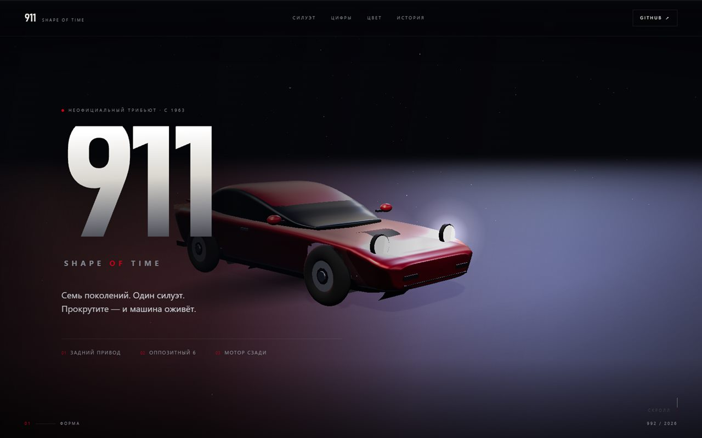

# 911 — Shape of Time

Кинематографичный 3D-трибьют Porsche 911. Одна страница, живая сцена на WebGL, скролл-хореография камеры и процедурная модель — без единого внешнего 3D-ассета.

**Демо:** https://sitecraft-studio.github.io/porsche-911-3d/



## Что внутри

- **Живая 3D-сцена.** Three.js (r160), PBR-материалы с clearcoat, процедурное студийное окружение (PMREM), мягкие тени, пыль в воздухе.
- **Машина собрана кодом.** Кузов — лофт суперэллиптических сечений с настоящими вырезами арок; кабина — отдельный лофт с раскладкой материалов «стекло/краска» по нормалям; колёса, фары, дуктейл, зеркала и шильдик — процедурная геометрия. Ни одной скачанной модели или текстуры.
- **Скролл-хореография.** Секция «Силуэт» закреплена на 280vh: пока вы скроллите, камера облетает машину с 3/4 спереди до 3/4 сзади. Положение камеры интерполируется по ключевым кадрам с демпфированием.
- **Интерактив.** Выбор цвета кузова (с плавным лерпом), параллакс от мыши, магнитные кнопки, кастомный курсор, счётчики характеристик, зерно и винъетка.
- **Без сборки.** Обычные `<script>`, всё вендорено в репозиторий: страница открывается двойным кликом и работает офлайн.

## Стек

`Three.js` · `WebGL` · `CSS 3D/анимации` · `vanilla JS` · шрифты Anton и Inter (OFL)

## Структура

```
index.html            разметка и контент
assets/css/style.css  дизайн-система, типографика, анимации
assets/js/car.js      процедурная геометрия 911
assets/js/main.js     сцена, свет, камера, скролл, UI
vendor/three.min.js   вендоренный Three.js r160
fonts/                Anton + Inter (woff2, OFL)
```

## Запуск

Откройте `index.html` в браузере — этого достаточно.

Если нужен локальный сервер:

```bash
python -m http.server 8080
# затем http://localhost:8080
```

## Отладка сцены

- `?shot=hero` — детерминированный кадр для скриншотов: `hero`, `shape`, `numbers`, `paint`, `line`, `final` + `&t=0..1` для прогресса внутри секции.
- `_tools/model.html` — четыре вида модели (side / front 3-4 / rear 3-4 / top) для проверки геометрии.
- `?shot=<...>` также включает упрощённый рендер (pixel ratio 1, тень 1024) — удобно для CI-скриншотов.

## Лицензия

Код — MIT (см. `LICENSE`).

**Дисклеймер.** Неофициальный фанатский проект. Porsche, 911 и связанные обозначения — товарные знаки Porsche AG. Проект не связан с производителем и не использует его материалы; модель автомобиля полностью сгенерирована кодом.
